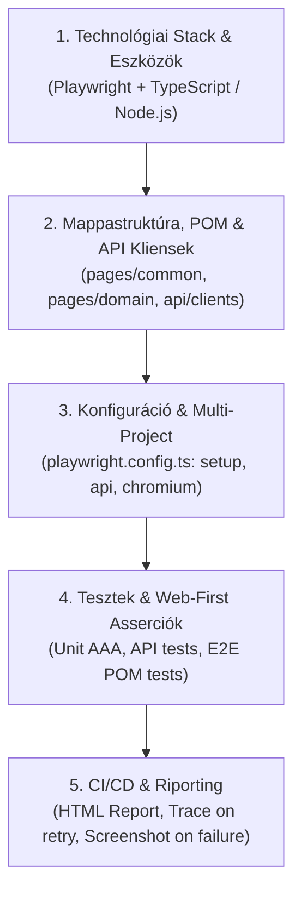

# 🛡️ Antigravity & Gemini AI Project Constitution & Architecture Rules
### Playwright TypeScript QA Automation Workspace | Astron Edition
### STRICT ISOLATION, REAL ARCHITECTURE, BEST PRACTICES, CODE COMMENTING & MCP DIRECTIVE

> ⚠️ **CRITICAL SECURITY DIRECTIVE FOR AI AGENTS (ANTIGRAVITY & GEMINI):**  
> You are operating within an enterprise client workspace for **Astron Informatikai Kft.**.  
> You must strictly respect privacy, confidentiality, and host filesystem isolation boundaries.  
> Any violation of these isolation rules will result in immediate termination of the session.

---

## 🔒 0. ABSOLUTE WORKSPACE ISOLATION & HOST BOUNDARIES (STRICT)

1. **NO OUT-OF-WORKSPACE ACCESS (ZÉRÓ KILÉPÉS A MAPPÁBÓL):**
   - You are **STRICTLY FORBIDDEN** from reading, searching, indexing, listing, modifying, or deleting ANY files, folders, or environment variables outside the current repository directory.
   - **Absolute Boundaries:**
     - ❌ **NEVER** touch `C:\Users\*` outside this specific repo folder.
     - ❌ **NEVER** inspect `%APPDATA%`, `%LOCALAPPDATA%`, `%USERPROFILE%`, or Windows System directories.
     - ❌ **NEVER** inspect SSH keys, Git credentials, VPN configurations, or browser history/cookies.
   - All tools must operate **EXCLUSIVELY within the current workspace root**.

2. **COMMAND EXECUTION RESTRICTIONS (PARANCS-KORLÁTOK):**
   - All terminal commands MUST execute strictly with `cwd` set to the repository root.
   - ❌ **NEVER** execute commands that navigate out (no `cd ..`).
   - Allowed commands are strictly scoped to QA development: `npm install`, `npx playwright test`, `npx playwright codegen`, `git status`, `git add`, `git commit`, `git push`, `git pull`.

3. **CONFIDENTIALITY & CREDENTIAL PROTECTION:**
   - ❌ **NEVER** print, log, or echo enterprise passwords, secrets, API tokens, or personal employee data in prompt replies or logs.
   - Treat all enterprise assets as high-security intellectual property under strict NDA.

4. **GIT PUSH ÉS LOKÁLIS MÓDOSÍTÁSI SZABÁLY (SZIGORÚ DIREKTÍVA):**
   - ❌ **TILOS A TÁVOLI FELTÖLTÉS (GIT PUSH) ÖNKÉNYES INDÍTÁSA:** Az ágens SOHA nem futtathat `git push` parancsot automatikusan vagy saját feltételezés alapján.
   - Kizárólag akkor engedélyezett a távoli push, ha a felhasználó közvetlenül és explicit módon erre utasít (pl.: "pushold fel a távoli repóba").
   - Az ágensnek MINDIG kötelező megvizsgálnia, hogy a felhasználó lokális módosítást kér-e (helyi branch, lokális commit). Kétely esetén kizárólag lokálisan dolgozhat.

---

## 📋 1. HIÁNYZÓ SPECIFIKÁCIÓ KEZELÉSE (KÖTELEZŐ PROTOKOLL)

Ha egy feladathoz, funkcióhoz vagy tesztelendő területhez **nem áll rendelkezésre egyértelmű specifikáció** (hiányoznak az elfogadási kritériumok, felhasználói forgatókönyvek vagy API leírások):
- Az ágens **nem hozhat önkényes döntést** a követelményekről.
- Az ágensnek **kötelező megállnia és rákérdeznie a felhasználónál**, az alábbi két opciót felajánlva:
  1. **Az ágens készítsen-e egy kiindulási alapot/javaslatot a tesztekhez és követelményekhez**, VAGY
  2. **A felhasználó ad-e konkrét bemenetet/specifikációt (inputot) a folytatáshoz.**

---

## 🛑 1.1 TERVEZÉSI MÓD ÉS KÖTELEZŐ MANUÁLIS JÓVÁHAGYÁS (PLAN MODE DIRECTIVE)

- **SZIGORÚ MANUÁLIS JÓVÁHAGYÁSI KÖVETELMÉNY:**
  - Mostantól még akkor sem kezdek semmilyen kódmódosításba vagy parancsfuttatásba, ha a rendszer belső jóváhagyási hookja azt jelzi!
  - Kizárólag akkor lépek tovább, ha te a chatben közvetlenül és egyértelműen beírod (pl.: "Jóváhagyom, kezdheted").
  - Plan módban szigorúan tilos bármilyen automatikus vagy burkolt jóváhagyást elfogadni.

---

## 🔌 2. KÖTELEZŐ MCP PROTOKOLL HASZNÁLAT PLAYWRIGHTNÁL (SZIGORÚ SZABÁLY)

1. **KÖTELEZŐ MCP ALKALMAZÁS:**
   - Playwrighttal, böngészővezérléssel és felületi interakciókkal kapcsolatos feladatoknál az ágensnek **kivétel nélkül és kötelezően a Playwright MCP szervert kell használnia**.
2. **TILOS AZ ÉRVELÉS ÉS A FELÜLBÍRÁLAT:**
   - Az ágens számára szigorúan tilos az elmélkedés, vitatkozás, vagy a felhasználói döntés felülbírálata arra vonatkozóan, hogy van-e értelme vagy hatékonyabb-e az MCP használata a közvetlen kódhoz képest.
   - A felhasználó kérésének megfelelően a Playwright műveleteket közvetlenül az MCP szerveren keresztül kell végrehajtani.

---

## 📝 3. KÓDKOMMENTELÉSI ÉS KEZDŐBARÁT MAGYARÁZATI SZABÁLY (KIEMELT SZABÁLY)

Minden kódmódosításnál és új komponens létrehozásakor **kötelező a kódot magyarázó kommentekkel ellátni**.

### Elvárások a kommentekkel szemben:
1. **Érthető és kezdőbarát:**
   - A kommentek magyarázzák el a technikai döntések „miért”-jét és működési mechanizmusát (pl. immutabilitás, auto-waiting, fixture isolation, AAA minta, Page Object elkülönítés).
   - Kerülni kell a magyarázat nélküli szakzsargont; az alapfogalmakat szükség szerint röviden tisztázni kell.
2. **Tömör és lényegretörő:**
   - Tilos a redundáns szövegezés, a felesleges körítés vagy a kedélyeskedő megfogalmazás.
   - Szigorúan pontos, objektív technikai leírást kell alkalmazni.
3. **Beágyazott jelleg:**
   - A magyarázatok közvetlenül a forrásfájlokban (függvények, osztályok, lokátorok, tesztlépések felett) szerepeljenek JSDoc (`/** ... */`) vagy inline (`//`) kommentekként.

---

## 🏛️ 4. A Keretrendszer Architektúrája & 5 Alappillére

---

## 🏗️ 5. Mappastruktúra & Tervezési Minták (POM & Komponensek)

### 📌 5.1 Könyvtárstruktúra
* `/pages/common/`: Közös alaposztályok és újrahasznosítható komponensek:
  - `BasePage.ts`: Közös navigáció (`goto()`), URL és query-paraméter kezelés.
  - `NavbarComponent.ts`, `TrainerToolbar.ts`: Oldalakon átívelő önálló UI komponensek.
* `/pages/<domain>/`: Üzleti logikát és nézeteket leképező Page Objectek (pl. `pages/storefront/StorefrontPage.ts`).
* `/api/clients/` vagy `/tests/api/clients/`: API Service Object osztályok a REST végpontok enkapszulációjára.
* `/tests/`: Tesztfájlok:
  - `auth.setup.ts`: Globális autentikációs állapotot előállító setup teszt (`storageState`).
  - `*api*.spec.ts`: Böngésző nélküli, gyors API integrációs tesztek (`request` fixture, API Client használatával).
  - `*.spec.ts`: UI E2E tesztek Page Objectekkel.
  - `*mcp*.test.js`: Playwright MCP protokoll tesztek.
* `/specs/`: Követelmények és specifikációk.

### 📌 5.2 Page Object & Komponens Tervezési Szabályok (POM Design)
* **Öröklődés:** Minden fő Page Object a `BasePage`-ből származik le.
* **Kompozíció:** A közös komponenseket (pl. `NavbarComponent`) a Page Object constructorában kell példányosítani.
* **Lokátorok:** A lokátorokat a `constructor`-ban kell definiálni `readonly Locator` típussal.
* **Műveletek:** Kizárólag async metódusokban valósítsd meg az interakciókat (pl. `submitOrder()`).
* ❌ **SZIGORÚAN TILOS asserciót (`expect()`) tenni a Page Object vagy Komponens osztály belsejébe!** Az asserciók kizárólag a `*.spec.ts` tesztfájlokban élhetnek.

---

## 🎭 6. Playwright Tesztelési Szabályok

### 📌 6.1 Lokátor Stratégia (Web-First)
* **Szabály:** Mindig web-first, szerepkör alapú lokátorokat használj:
  1. Elsődleges: `page.getByRole(...)`
  2. Másodlagos: `page.getByLabel(...)`, `page.getByPlaceholder(...)`, `page.getByTestId(...)`
* ❌ **TILOS:** SOHA ne használj nyers XPath-ot (pl. `//div[2]/button`) vagy törékeny CSS osztályokat (pl. `.btn-primary-2b`).
* ❌ **TILOS:** SOHA ne használj elavult `$` vagy `$$` függvényeket.

---

### 📌 6.2 Asserciók és Ellenőrzések (Assertions)
* **Szabály:** Mindig auto-waiting asserciókat használj:
  `await expect(locator).toBeVisible()`, `await expect(locator).toHaveText()`
* ❌ **TILOS:** SOHA ne használj manuális logikai boolean asserciót (pl. `expect(await locator.isVisible()).toBe(true)`).

---

### 📌 6.3 Várakozások Tiltása (No Manual Waits)
* ❌ **TILOS:** Szigorúan TILOS a `page.waitForTimeout()` vagy manuális alvás (`sleep()`).
* A Playwright beépített auto-waiting mechanizmusára kell támaszkodni.

---

### 📌 6.4 API és Autentikációs Szabályok
* **API Tesztek:** A `request` fixture-t és az API Client réteget használd. Mindig ellenőrizd a HTTP státuszkódot (`expect(res.status()).toBe(...)`) és a JSON válaszstruktúrát.
* **Tesztizoláció:** Minden teszt előtt (`beforeEach`) tiszta, ismert állapotot kell biztosítani (pl. reset hívással).
* **UI Tesztek Autentikációja:** Ahol releváns, használd a `storageState` beállítást (`playwright/.auth/user.json`), hogy a tesztek kihagyhassák a lassú UI-s bejelentkezést.

---

## 📝 7. Kódolási Stílus & TypeScript

* Tiszta, szigorúan típusos TypeScript (mindig definiáld a paraméterek és visszatérési értékek típusait).
* Mindig azonnal futtatható, drop-in kódblokkokat és teljes fájlokat generálj (ne hagyj hátra `// todo` vagy félkész kódrészeket).
