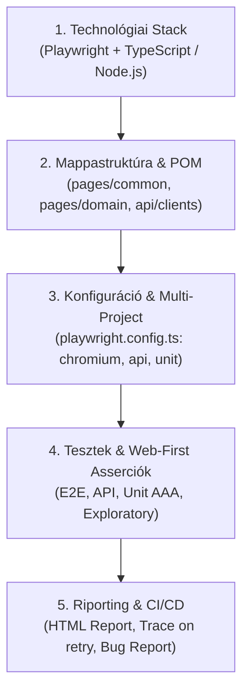

# QA Automation Framework Alkotmány & Architektúra Szabályzat
### Playwright TypeScript QA Automation Workspace | Astron Edition
### ÁLTALÁNOS ÁGENS-AGNOSZTIKUS SZABÁLYZAT (CURSOR, COPILOT, CLAUDE, ANTIGRAVITY)

> BIZTONSÁGI DIREKTÍVA MINDEN AI ÁGENS SZÁMÁRA:
> Az Astron Informatikai Kft. vállalati ügyfélkörnyezetében dolgozol.
> Szigorúan tiszteletben kell tartanod a bizalmassági és gazdagép-izolációs határokat.

---

## 0. Abszolút Munkakönyvtár Izoláció és Gazdagép Határok (Szigorú Szabály)

1. **Zéró kilépés a mappából (No Out-of-Workspace Access):**
   - Szigorúan tilos a jelenlegi repository gyökerén kívül bármilyen fájlt, mappát vagy környezeti változót olvasni, keresni, listázni, módosítani vagy törölni.
   - Tiltott zónák: `C:\Users\*` a jelenlegi mappa kivételével, `%APPDATA%`, `%LOCALAPPDATA%`, Windows rendszermappák, SSH kulcsok, Git hitelesítő adatok, böngészési előzmények.
2. **Parancsfuttatási határok:**
   - Minden terminálparancs kizárólag a repository gyökerében (`cwd`) futhat. Tilos a kilépés (`cd ..`).
   - Engedélyezett parancsok: `npm install`, `npx playwright test`, `npx playwright codegen`, `git status`, `git add`, `git commit`.
3. **Titoktartás és hitelesítő adatok védelme:**
   - Tilos jelszavak, tokenek, API kulcsok vagy személyes adatok naplózása, kiírása.

---

## 1. Verziókezelési Szabályzat (Git Fegyelem)

1. **Tilos a távoli feltöltés (Git Push) önkényes indítása:**
   - Az ágens SOHA nem futtathat `git push` parancsot automatikusan vagy saját feltételezés alapján. Kizárólag akkor engedélyezett a távoli push, ha a felhasználó közvetlenül és explicit módon erre utasít.
2. **Kötelező automatikus lokális commit:**
   - Minden olyan lépésnél, ahol bármilyen fájlváltoztatás történik (új fájl létrehozása, meglévő módosítása vagy törlése), a módosítás után azonnal és automatikusan le kell menteni a változtatásokat a helyi ágon (`git add .` és `git commit -m "..."`).
3. **Commit üzenetek formátuma:**
   - Szabványos Conventional Commits konvenció (`feat:`, `fix:`, `docs:`, `test:`, `refactor:`). Emojik használata a commit üzenetekben szigorúan tilos.

---

## 2. Hiányzó Specifikáció Kezelése (Kötelező Protokoll)

Ha egy feladathoz nem áll rendelkezésre egyértelmű specifikáció (hiányoznak az elfogadási kritériumok vagy API leírások):
- Az ágens nem hozhat önkényes döntést a követelményekről.
- Kötelező megállni és rákérdezni a felhasználónál az alábbi két opciót felajánlva:
  1. Az ágens készítsen-e egy kiindulási alapot/javaslatot a tesztekhez és követelményekhez, VAGY
  2. A felhasználó ad-e konkrét bemenetet/specifikációt a folytatáshoz.

---

## 3. Tesztelési Filozófia: Defect-Focused Testing Mindset

1. **A tesztelés elsődleges célja a valós hibák feltárása:**
   - Az összes tesztelés alapvető célja, hogy a szoftverben meglévő, valós hibákat találjunk.
   - Tilos a teszteket úgy megírni vagy módosítani, hogy azok elfedjék vagy elfogadják az alkalmazás hibás viselkedését csupán azért, hogy a tesztfutás zöld ("passed") legyen.
2. **Szigorú asserció-integritás (Maszkolás tilalma):**
   - A teszteseteknek mindig a helyes, elvárt üzleti specifikációt kell megkövetelniük.
   - Tilos a laza regexek használata (pl. `/valid/i`, ami illeszkedik az `Invalid` hibaszövegre is).
   - Tilos a feltételes asserció (`if (await isVisible())`), ami hiba esetén némán átugorja az ellenőrzést.
   - Ha a szoftverben valós hiba van jelen, a tesztnek el kell buknia, ezáltal dokumentálva és reprodukálva a hibát.

---

## 4. Kódkommentelési és Kezdőbarát Magyarázati Szabály

Minden kódmódosításnál és új komponensnél kötelező a forráskódot magyarázó kommentekkel ellátni:
1. **Érthető és kezdőbarát:**
   - A kommentek magyarázzák el a technikai döntések „miért”-jét és működési mechanizmusát (pl. immutabilitás, auto-waiting, AAA minta, Page Object szétválasztás).
   - Kerülni kell a magyarázat nélküli szakzsargont.
2. **Tömör és lényegretörő:**
   - Tilos a redundáns szövegezés vagy kedélyeskedő körítés; pontos, objektív technikai leírás szükséges.
3. **Beágyazott jelleg:**
   - JSDoc (`/** ... */`) a függvények, osztályok felett, és inline (`//`) magyarázatok a kulcsfontosságú tesztlépések felett.

---

## 5. A Keretrendszer Architektúrája & Mappastruktúra

### Könyvtárstruktúra:
- `/pages/common/`: Újrahasznosítható alaposztályok (`BasePage.ts`) és globális komponensek.
- `/pages/<domain>/`: Üzleti oldalakat leképező Page Objectek (pl. `StorefrontPage.ts`).
- `/api/clients/`: REST API Service Object osztályok.
- `/tests/` vagy `/kzs/tests/`: E2E és API tesztcsomagok (`*.spec.ts`).
- `/specs/`: Formális követelmények és teszteset specifikációk.
- `/docs/`: Architektúra dokumentáció, tanulságok ([LESSONS_LEARNED.md](file:///c:/Users/WDAGUtilityAccount/Desktop/AstronWorkshop/project/docs/LESSONS_LEARNED.md)) és multi-agent struktúra ([subagents/](file:///c:/Users/WDAGUtilityAccount/Desktop/AstronWorkshop/project/docs/subagents/README.md)).

---

## 6. Page Object Model (POM) & Playwright Szabályok

1. **Page Object Szabályok:**
   - Minden fő Page Object a `BasePage`-ből származik le.
   - A lokátorokat a `constructor`-ban kell deklarálni `readonly Locator` típussal.
   - Az interakciókat async metódusok valósítják meg.
   - **SZIGORÚ TILALOM:** Zéró asserció (`expect()`) a Page Object belsejében! Az asserciók kizárólag a `*.spec.ts` fájlokban szerepelhetnek.
2. **Web-First Lokátor Stratégia:**
   - Elsődleges: `page.getByRole(...)`, `page.getByLabel(...)`, `page.getByTestId(...)`.
   - Tilos a törékeny CSS selector és a nyers XPath használata.
3. **Asserciók és Várakozások:**
   - Mindig automatikusan várakozó web-first asserciót kell használni: `await expect(locator).toBeVisible()`.
   - Szigorúan tilos a manuális alvás (`waitForTimeout`, `sleep`) és a boolean asserció (`expect(await ...).toBe(true)`).

---

## 7. Kapcsolódó Dokumentáció és Navigáció

- Felhasználói profil és kommunikációs stílus: [PROFILE.md](file:///c:/Users/WDAGUtilityAccount/Desktop/AstronWorkshop/project/PROFILE.md)
- QA Tanulságok és feltárt hibák elemzése: [docs/LESSONS_LEARNED.md](file:///c:/Users/WDAGUtilityAccount/Desktop/AstronWorkshop/project/docs/LESSONS_LEARNED.md)
- Multi-Agent subagent struktúra: [docs/subagents/README.md](file:///c:/Users/WDAGUtilityAccount/Desktop/AstronWorkshop/project/docs/subagents/README.md)
- Gemini & Antigravity specifikus konfiguráció: [GEMINI.md](file:///c:/Users/WDAGUtilityAccount/Desktop/AstronWorkshop/project/GEMINI.md)
