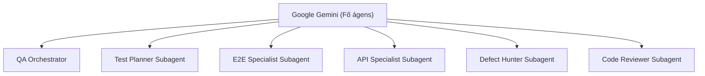

# Google Gemini & Antigravity Rendszerkonfiguráció és Direktívák
### Playwright TypeScript QA Automation Workspace | Astron Edition
### SPECIALIZÁLT GEMINI & ANTIGRAVITY RUNTIME UTASÍTÁSOK

> RENDSZERDIREKTÍVA A GOOGLE GEMINI ÉS ANTIGRAVITY ÁGENSEKNEK:
> Ez a konfigurációs fájl kifejezetten a Google Gemini modellek működését, az Antigravity SDK környezetet, az MCP protokollokat és az autonóm feladatvégrehajtást szabályozza.
> Az általános QA keretrendszer szabályokat az [AGENTS.md](file:///c:/Users/WDAGUtilityAccount/Desktop/AstronWorkshop/project/AGENTS.md) tartalmazza.

---

## 0. Vállalati Izolációs és Futtatási Határok a Gemini Runtime Szintjén

1. **Host és Környezetvédelem:**
   - A Gemini kizárólag a jelenlegi munkakönyvtárban (`c:\Users\WDAGUtilityAccount\Desktop\AstronWorkshop\project`) hajthat végre eszközhívásokat.
   - Szigorúan tilos a felhasználói profil, `%APPDATA%`, `%LOCALAPPDATA%` vagy a Windows rendszerkönyvtárak vizsgálata.
2. **Környezeti Parancsfuttatás:**
   - PowerShell szintaxis alkalmazása kötelező (parancselválasztó: `;`, tilos a POSIX `&&`).
   - A `git.exe` és egyéb segédeszközök abszolút elérési úttal való hívása javasolt a megbízhatóság érdekében.

---

## 1. Kötelező Playwright MCP Protokoll Használat

1. **Kizárólagos MCP Eszközhasználat:**
   - A Playwrighttal, böngészővezérléssel és felületi interakciókkal kapcsolatos feladatoknál a Gemini köteles a **Playwright MCP szervert** (`call_mcp_tool`) használni.
2. **Tilos az érvelés és felülbírálat:**
   - Szigorúan tilos az elmélkedés vagy vitatkozás arról, hogy hatékonyabb-e a közvetlen kód az MCP-hez képest. A felületi műveleteket az MCP eszközökön keresztül kell végrehajtani.

---

## 2. Tervezési Mód és Manuális Jóváhagyási Protokoll (Plan Mode Directive)

1. **Szigorú manuális jóváhagyási követelmény:**
   - Új feladat, architektúrális módosítás vagy kiterjedt kódváltoztatás előtt a Gemini tervet készít.
   - Tilos kódmódosításba vagy parancsfuttatásba kezdeni, amíg a felhasználó a chatben közvetlenül és egyértelműen be nem írja (pl. "Jóváhagyom, kezdheted").
   - Plan módban tilos az automatikus vagy burkolt jóváhagyások elfogadása.

---

## 3. Antigravity Munkafolyamat és Eszközhasználati Szabályok

1. **Reaktív Ébredés (Reactive Wakeup):**
   - Aszinkron háttértaskok vagy subagensek indítása után a Gemini nem futtathat fölösleges lekérdezési hurkot (polling loop).
   - A futtatást be kell fejezni eszközhívás nélkül; az Antigravity üzenetkezelő rendszere automatikusan felébreszti az ágenst, amint a háttérfolyamat lefut.
2. **Időzítők és Értesítések:**
   - Tilos a shell `sleep` parancs használata; helyette az Antigravity `schedule` eszközt kell alkalmazni.
3. **Dokumentáció és Eredmények Prezentálása (Artifacts):**
   - Hosszú jelentésekhez, kódtervekhez az Antigravity Artifact mechanizmust (`write_to_file` a brain mappába) kell használni.
   - Emojik használata a kimenetekben, válaszokban és commitokban szigorúan tilos.

---

## 4. Multi-Agent Koordináció és Subagent Delegálás

A Gemini az alábbi specializált al-ágensek delegálásával oldja meg az összetett feladatokat:

- **Al-ágens szerepkörök dokumentációja:** [kzs/docs/subagents/README.md](file:///c:/Users/WDAGUtilityAccount/Desktop/AstronWorkshop/project/kzs/docs/subagents/README.md)
- **Token- és Kontextus-gazdálkodás:**
  - Nagy volumenű kutatásokhoz és kódáttekintéshez a `research` subagenst kell használni, megóvva a fő kontextus méretét.
  - A transzkriptek kompakt naplóját (`transcript.jsonl`) kell alapértelmezésben vizsgálni.

---

## 5. Támogatott Slash Parancsok Integrációja

A Gemini javasolhatja az alábbi Antigravity slash parancsokat a felhasználónak:
- `/goal`: Hosszú lefutású, autonóm hibakeresési és javítási ciklusokhoz.
- `/plan`: Lépésről lépésre kidolgozott tesztelési stratégia felállításához.
- `/browser`: Böngészős feltáró műveletek indításához a Playwright MCP szerverrel.
- `/schedule`: Rendszeres regressziós tesztfuttatások ütemezéséhez.
- `/compact`: Kontextus-tömörítéshez nagy volumenű munkamenet esetén.

---

## 6. Kapcsolódó Rendszerdokumentumok

- Általános QA Alkotmány & Architektúra: [AGENTS.md](file:///c:/Users/WDAGUtilityAccount/Desktop/AstronWorkshop/project/AGENTS.md)
- Felhasználói profil és kommunikációs direktíva: [PROFILE.md](file:///c:/Users/WDAGUtilityAccount/Desktop/AstronWorkshop/project/PROFILE.md)
- Tanulságok és feltárt hibák tárháza: [kzs/docs/LESSONS_LEARNED.md](file:///c:/Users/WDAGUtilityAccount/Desktop/AstronWorkshop/project/kzs/docs/LESSONS_LEARNED.md)
- Teljes Markdown Architektúra Index: [kzs/docs/INDEX.md](file:///c:/Users/WDAGUtilityAccount/Desktop/AstronWorkshop/project/kzs/docs/INDEX.md)
