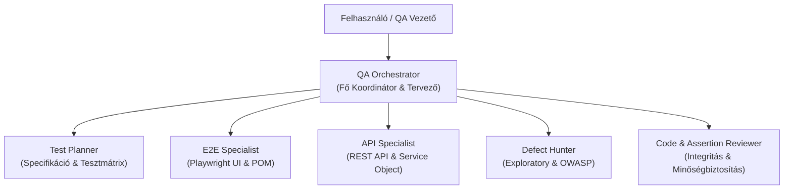

# Multi-Agent QA Architektúra és Subagent Rendszer
### Astron Informatikai Kft. | Playwright QA Automation Workspace

Ez a dokumentáció mutatja be a Playwright keretrendszerhez kialakított specializált al-ágens (subagent) szerepköröket, felelősségi köröket és együttműködési munkafolyamatokat.

---

## 1. A Multi-Agent Megközelítés Célja

A komplex szoftverminőség-biztosítási feladatok felosztása specializált ágensek között növeli a tesztelési alaposságot, megelőzi a teszt-maszkolást és biztosítja az enterprise szintű kódminőséget.

---

## 2. A Subagensek Szerepkörei

| Subagent Megnevezése | Dokumentáció | Elsődleges Felelősségi Kör |
|---|---|---|
| **QA Orchestrator** | [qa-orchestrator.md](file:///c:/Users/WDAGUtilityAccount/Desktop/AstronWorkshop/project/docs/subagents/qa-orchestrator.md) | Feladatbontás, koordináció, kontextus-menedzsment és záró szintézis. |
| **Test Planner** | [test-planner.md](file:///c:/Users/WDAGUtilityAccount/Desktop/AstronWorkshop/project/docs/subagents/test-planner.md) | Specifikációelemzés, teszteset-tervezés, határérték-elemzés (BVA) és ekvivalencia-osztályok. |
| **E2E Specialist** | [e2e-specialist.md](file:///c:/Users/WDAGUtilityAccount/Desktop/AstronWorkshop/project/docs/subagents/e2e-specialist.md) | Playwright UI E2E tesztek kódolása, Page Object Model (POM) osztályok készítése, web-first lokátorok. |
| **API Specialist** | [api-specialist.md](file:///c:/Users/WDAGUtilityAccount/Desktop/AstronWorkshop/project/docs/subagents/api-specialist.md) | Böngésző nélküli gyors API tesztek (`request` fixture), Service Object réteg, státuszkódok és payloadok validálása. |
| **Defect Hunter** | [defect-hunter.md](file:///c:/Users/WDAGUtilityAccount/Desktop/AstronWorkshop/project/docs/subagents/defect-hunter.md) | Feltáró (exploratory) tesztelés, negatív határesetek, állapotgép-anomáliák, alapvető OWASP sebezhetőségek feltárása. |
| **Code Reviewer** | [code-reviewer.md](file:///c:/Users/WDAGUtilityAccount/Desktop/AstronWorkshop/project/docs/subagents/code-reviewer.md) | Kódminőség, kezdőbarát kommentálás ellenőrzése, teszt-maszkolási hibák (laza regexek, feltételes asserciók) kiszűrése. |

---

## 3. Együttműködési Munkafolyamat (Workflow)

1. **Követelményfogadás & Elemzés:** A `QA Orchestrator` átveszi a felhasználói igényt és delegál a `Test Planner`-nek.
2. **Specifikáció & Tervezés:** A `Test Planner` előállítja a tesztforgatókönyveket a specifikációs mappába (`specs/`).
3. **Implementáció:**
   - Felületi funkciók esetén az `E2E Specialist` hozza létre a Page Objecteket és teszteket.
   - Végpontok esetén az `API Specialist` készíti el az API teszteket és klienseket.
4. **Feltáró és Sebezhetőségi Vizsgálat:** A `Defect Hunter` azonosítja a specifikációból hiányzó peremeseteket és állapotgép-réseket.
5. **Kód- és Asserció-felülvizsgálat:** A `Code Reviewer` auditálja az elkészült teszteket a maszkolt asserciók és kommentelési szabályok szempontjából.
6. **Záró Szintézis & Riporting:** Az `Orchestrator` összefoglalja az eredményeket és futtatja a Playwright HTML riportot.
