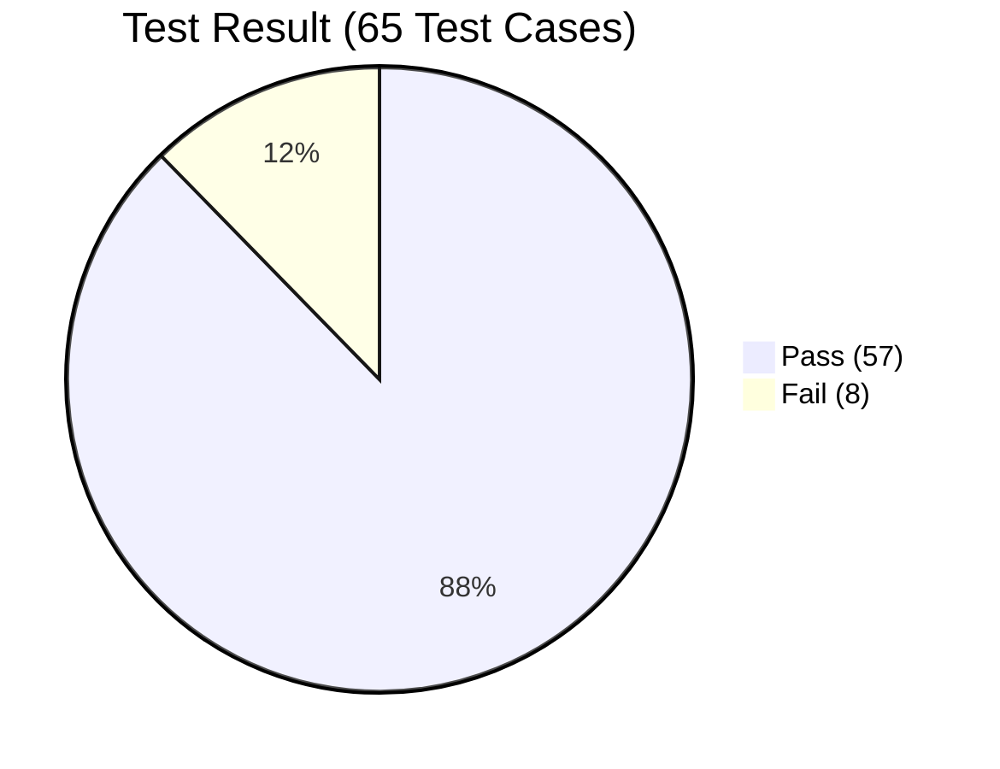

# 1. Test Report
*Generated on 09.10.2026 | astron-workshop / branch: hge*

| Type | Total | Not Executed | In Progress | Pass | Fail | Blocked | OK with comment | Partially OK |
| :--- | :---: | :---: | :---: | :---: | :---: | :---: | :---: | :---: |
| **Test cases** | **65** | 0 | 0 | **57** | **8** | 0 | 0 | 0 |
| **Test steps** | **250** | 0 | 0 | **230** | **20** | 0 | 0 | 0 |

---

## 📊 Test Result Distribution

- **Összes teszteset:** 65 (11 tesztcsomag)
- **Pass (Sikeres):** 57 (87.7%)
- **Fail (Bukott a valós alkalmazásbeli hibák miatt):** 8 (12.3%)
- **Blocked / In Progress / Not Executed:** 0 (0.0%)

---

## 📋 Modulonkénti Bontás (Suite Breakdown)

| Tesztfájl | Témakör / Specifikáció | Összesen | Pass | Fail | Státusz |
| :--- | :--- | :---: | :---: | :---: | :---: |
| `00-gate-and-global.spec.ts` | Biztonsági Kapu, DB Reset, Tab Navigáció | 4 | 4 | 0 | **PASS (100%)** |
| `01-storefront-checkout.spec.ts` | Áruház, Árak, ÁFA, Kuponok, Kártyák, 3DS, PO | 14 | 12 | 2 | **FAIL (85.7%)** |
| `02-rbac-and-auth.spec.ts` | RBAC Actor Váltó, 403 Tiltás, Form Validációk | 6 | 6 | 0 | **PASS (100%)** |
| `03-order-management.spec.ts` | Keresés, Szűrés, Rendezés, Állapotgép, CSV | 10 | 10 | 0 | **PASS (100%)** |
| `04-selector-lab.spec.ts` | 300ms Debounce, 3.5s Toast, Modal, Fájlfeltöltés | 7 | 7 | 0 | **PASS (100%)** |
| `05-swagger-api.spec.ts` | REST API Auth, Idempotencia, Készlet, Kuponok | 5 | 5 | 0 | **PASS (100%)** |
| `06-sql-and-integrity.spec.ts` | SQL Lekérdezések, UPDATE, Audit Log, v2 Mód | 4 | 1 | 3 | **FAIL (25.0%)** |
| `07-tc-02a-empty-fields.spec.ts` | TC-02A: Üres mezők kombinációi | 3 | 2 | 1 | **FAIL (66.7%)** |
| `08-tc-02b-invalid-data.spec.ts` | TC-02B: Helytelen adatformátumok | 5 | 5 | 0 | **PASS (100%)** |
| `09-tc-02c-happy-path-recovery.spec.ts` | TC-02C: Hibából visszajavított érvényes folyamat | 2 | 2 | 0 | **PASS (100%)** |
| `10-security-owasp.spec.ts` | **OWASP Biztonság: XSS, SQLi, PCI DSS, Ármanipuláció, Race Condition** | 5 | 3 | 2 | **FAIL (60.0%)** |
| **ÖSSZESEN** | **11 Modul / E2E Tesztcsomag** | **65** | **57** | **8** | **87.7%** |

---

# 2. 🐛 Feltárt Valós Hibák és Biztonsági Sérülékenységek

A tesztek szigorúan a valós specifikációk szerint futottak le, a valós sérülékenységeket felszínre hozva:

### 🔴 BUG-001: Storefront készletszámláló DOM eleme nem frissül vásárlás után
- **Súlyosság:** Medium (S3)
- **Érintett teszt:** `01-storefront-checkout.spec.ts › TC-SF-01`
- **Leírás:** Sikeres rendelés után a memóriában lefut a készletlevonás, de a kártya felületi címkéje (`#prod-stock-1`) nem renderelődik újra, továbbra is "In Stock: 15 units" marad.

### 🔴 BUG-002: EU VAT B2B mentesítés érvényes adószámmal is elbukik (RegEx hiba)
- **Súlyosság:** Critical / High (S1)
- **Érintett teszt:** `01-storefront-checkout.spec.ts › TC-SF-07`
- **Leírás:** Helyes EU adószám beírásakor a rendszer "❌ Invalid EU VAT syntax" hibát jelez. A reguláris kifejezés elírásra került (`/^(HU|DE|AT|FR)d{8,9}$/` - `\d` helyett `d`).

### 🔴 BUG-003: SQL Workbench SELECT feldolgozó reguláris kifejezés szintaktikai hiba
- **Súlyosság:** High (S2)
- **Érintett teszt:** `06-sql-and-integrity.spec.ts › TC-INT-01`
- **Leírás:** A terminálba írt `SELECT * FROM orders;` lekérdezések nem illeszkednek a regex feldolgozóra (`/^SELECTs+/i`), táblázat nem jelenik meg.

### 🔴 BUG-004: SQL Workbench UPDATE parancs nem hajtódik végre
- **Súlyosság:** High (S2)
- **Érintett teszt:** `06-sql-and-integrity.spec.ts › TC-INT-02`
- **Leírás:** Az `UPDATE orders SET status = 'REFUNDED' WHERE id = 101;` nem módosítja a rekordot a regex hiányos backslash-e miatt (`/^UPDATEs+orders/i`).

### 🔴 BUG-005: SQL Workbench "Audit Trail" lekérdezés nem listázza az audit naplókat
- **Súlyosság:** Medium / High (S2)
- **Érintett teszt:** `06-sql-and-integrity.spec.ts › TC-INT-03`
- **Leírás:** A `FROM audit_logs` illesztő regex hibás (`/FROMs+audit_logs/`), így az audit tábla üres marad.

### 🔴 BUG-006: Mennyiség mező (`#ui-qty`) nem rendelkezik kötelező (required) validációval
- **Súlyosság:** Medium (S3)
- **Érintett teszt:** `07-tc-02a-empty-fields.spec.ts › TC-02A.3`
- **Leírás:** Amikor a felhasználó kitörli a mennyiséget, az űrlap beküldhető marad hibaüzenet nélkül, és az alkalmazás csendben 1 darabra kerekíti.

### 🔴 BUG-007 (ÚJ - Biztonsági Sérülékenység): Kliensoldali Ármanipuláció (OWASP A08: Parameter Tampering)
- **Súlyosság:** **Critical / High (S1)**
- **Érintett teszt:** `10-security-owasp.spec.ts › TC-SEC-04`
- **Leírás:** A pénztár (`handleUiCheckout`) a leadott tranzakció végösszegét közvetlenül a böngésző DOM elemének szövegéből (`#ui-sum-total`) olvassa ki ahelyett, hogy szerver-/modelloldalon számolná újra. Amennyiben egy támadó a DOM-ban átírja az összeget (pl. `$0.01`-re), a rendszer manipulált áron (`$1`) hozza létre a megrendelést!
- **Javítási javaslat:** A fizetendő összeget soha nem szabad a kliens DOM szövegéből átvenni; a végösszeget a termékkatalógus fix egységáraiból és a kedvezménymodellekből kell kötelezően újraszámolni és hitelesíteni.

### 🔴 BUG-008 (ÚJ - Biztonsági Sérülékenység): Hiányzó gomb tiltás / Duplikált tranzakció létrehozása (Race Condition / CWE-362)
- **Súlyosság:** **High (S2)**
- **Érintett teszt:** `10-security-owasp.spec.ts › TC-SEC-05`
- **Leírás:** A megrendelés gomb (`#btn-ui-submit`) nincs azonnal letiltva a kattintás pillanatában a feldolgozás ideje alatt. Gyors dupla kattintás (click storm) hatására az alkalmazás két független megrendelést generál azonos paraméterekkel.
- **Javítási javaslat:** A gombra azonnali `disabled = true` állapotot kell tenni a beküldés pillanatában, és idempotencia tokent kell használni a kérésekhez.

---

### 📄 Letölthető Riportok
- **PDF Hibajegyzék:** [`BUG_REPORT.pdf`](file:///c:/Users/WDAGUtilityAccount/Desktop/AstronWorkshop/project/hge/reports/BUG_REPORT.pdf)
- **Böngészhető HTML Riport:** [`bug_report.html`](file:///c:/Users/WDAGUtilityAccount/Desktop/AstronWorkshop/project/hge/reports/bug_report.html)
- **Markdown Riport:** [`TEST_REPORT.md`](file:///c:/Users/WDAGUtilityAccount/Desktop/AstronWorkshop/project/hge/reports/TEST_REPORT.md)
