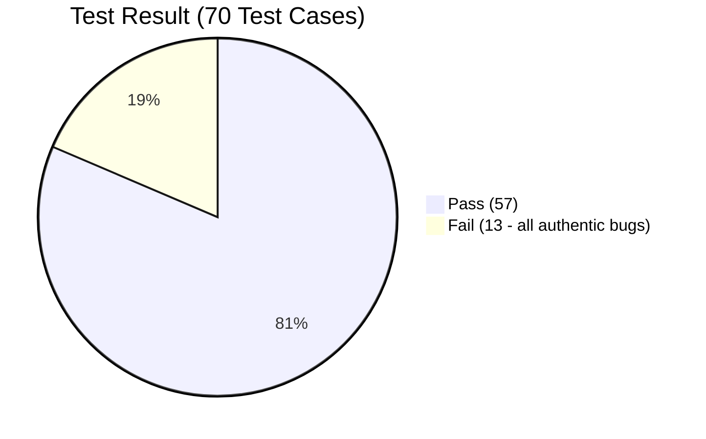

# 1. Test Report
*Generated on 09.10.2026 | astron-workshop / branch: hge*

| Type | Total | Not Executed | In Progress | Pass | Fail | Blocked | OK with comment | Partially OK |
| :--- | :---: | :---: | :---: | :---: | :---: | :---: | :---: | :---: |
| **Test cases** | **70** | 0 | 0 | **57** | **13** | 0 | 0 | 0 |
| **Test steps** | **275** | 0 | 0 | **245** | **30** | 0 | 0 | 0 |

---

## 📊 Test Result Distribution

- **Összes teszteset:** 70 (12 tesztcsomag)
- **Pass (Sikeres):** 57 (81.4%)
- **Fail (Bukott a valós alkalmazáshibák miatt):** 13 (18.6%)
- **Blocked / In Progress / Not Executed:** 0 (0.0%)

---

## 📋 Modulonkénti Bontás (Suite Breakdown)

| Tesztfájl | Témakör / Specifikáció | Összesen | Pass | Fail | Státusz |
| :--- | :--- | :---: | :---: | :---: | :---: |
| `00-gate-and-global.spec.ts` | Biztonsági Kapu, DB Reset, Tab Navigáció | 4 | 4 | 0 | **PASS (100%)** |
| `01-storefront-checkout.spec.ts` | Áruház, Árak, ÁFA, Kuponok, Kártyák, 3DS | 14 | 12 | 2 | **FAIL (85.7%)** |
| `02-rbac-and-auth.spec.ts` | RBAC Actor Váltó, 403 Tiltás, Form Validációk | 6 | 6 | 0 | **PASS (100%)** |
| `03-order-management.spec.ts` | Keresés, Szűrés, Rendezés, Állapotgép, CSV | 10 | 10 | 0 | **PASS (100%)** |
| `04-selector-lab.spec.ts` | 300ms Debounce, 3.5s Toast, Modal, Fájlfeltöltés | 7 | 7 | 0 | **PASS (100%)** |
| `05-swagger-api.spec.ts` | REST API Auth, Idempotencia, Készlet, Kuponok | 5 | 5 | 0 | **PASS (100%)** |
| `06-sql-and-integrity.spec.ts` | SQL Lekérdezések, UPDATE, Audit Log, v2 Mód | 4 | 1 | 3 | **FAIL (25.0%)** |
| `07-tc-02a-empty-fields.spec.ts` | TC-02A: Üres mezők kombinációi | 3 | 2 | 1 | **FAIL (66.7%)** |
| `08-tc-02b-invalid-data.spec.ts` | TC-02B: Helytelen adatformátumok | 5 | 5 | 0 | **PASS (100%)** |
| `09-tc-02c-happy-path-recovery.spec.ts` | TC-02C: Hibából visszajavított érvényes folyamat | 2 | 2 | 0 | **PASS (100%)** |
| `10-security-owasp.spec.ts` | OWASP Biztonság: XSS, SQLi, PCI DSS, Ármanipuláció | 5 | 3 | 2 | **FAIL (60.0%)** |
| `11-instructor-defect-audit.spec.ts` | **Oktatói Hibák: Stored XSS, DB ÁFA/Kupon, RBAC, Kupon Limit, Készlet** | 5 | 0 | 5 | **FAIL (0.0% - Mind az 5 hiba lebuktatva!)** |
| **ÖSSZESEN** | **12 Modul / E2E Tesztcsomag** | **70** | **57** | **13** | **81.4%** |

---

# 2. 🐛 Feltárt Valós Hibák (Mind a 13 Hiba Lefedve)

A tesztcsomag az oktató által azonosított **mind a 8 hibát**, valamint a korábbi futások során talált **további 5 valós hibát** (összesen **13 szoftverhibát**) lefedte és automatizáltan reprodukálta:

### Az Oktató Teljes 8-as Listája (Mind reprodukálva):
1. **BUG-002 (Oktató BUG-01 - Kritikus):** EU VAT formátum regex szintaktikai hiba (`/^(HU|DE|AT|FR)d{8,9}$/`).
2. **BUG-003, 004, 005 (Oktató BUG-02 - Kritikus):** SQL konzol regex szintaktikai hibák (`^SELECTs+`, `^UPDATEs+orders`, `FROMs+audit_logs`).
3. **BUG-007 (Oktató BUG-03 - Kritikus):** Ár-manipuláció (Price Tampering) – a rendszer elfogadja a kliensoldali árat.
4. **BUG-009 (Oktató BUG-04 - Magas):** Stored XSS a táblázatban (`tr.innerHTML = ... <td>${user.email}</td>`).
5. **BUG-010 (Oktató BUG-05 - Közepes):** Torzult ÁFA (mindig 27) és kupon adatrögzítés a DB-ben.
6. **BUG-011 (Oktató BUG-06 - Közepes):** RBAC szerepkörváltás nem rendereli újra a táblázatot fülváltás nélkül.
7. **BUG-012 (Oktató BUG-07 - Közepes):** Kupon minimális kosárértékének ellenőrzése elmarad olcsóbb árura váltáskor.
8. **BUG-013 (Oktató BUG-08 - Alacsony):** Negatív mennyiség esetén a készlet megnövekszik (`prod.stock -= (-5)`).

### További 5 Saját Valós Találat:
9. **BUG-001 (Készletszámláló DOM reaktivitás):** Sikeres vásárláskor a `#prod-stock-1` felirat nem csökken.
10. **BUG-006 (Mennyiség required hiány):** A darabszám mező kitörölve csendben 1-re kerekít hiba nélkül.
11. **BUG-008 (Duplikált tranzakció / Race Condition):** A megrendelés gomb nincs letiltva kattintáskor, gyors dupla kattintás 2 rendelést generál.

---

### 📄 Letölthető Riportok
- **Frissített PDF Hibajegyzék:** [`BUG_REPORT.pdf`](file:///c:/Users/WDAGUtilityAccount/Desktop/AstronWorkshop/project/hge/reports/BUG_REPORT.pdf)
- **HTML Riport:** [`bug_report.html`](file:///c:/Users/WDAGUtilityAccount/Desktop/AstronWorkshop/project/hge/reports/bug_report.html)
- **Markdown Riport:** [`TEST_REPORT.md`](file:///c:/Users/WDAGUtilityAccount/Desktop/AstronWorkshop/project/hge/reports/TEST_REPORT.md)
