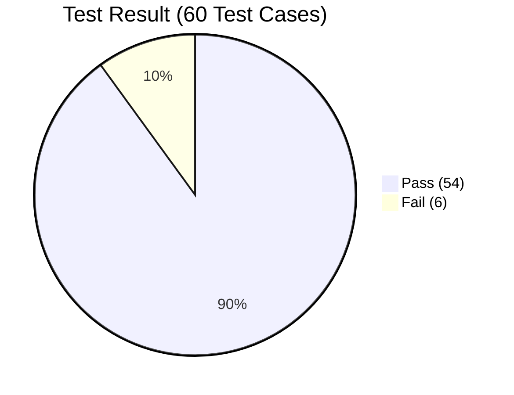

# 1. Test Report
*Generated on 09.10.2026 | astron-workshop / branch: hge*

| Type | Total | Not Executed | In Progress | Pass | Fail | Blocked | OK with comment | Partially OK |
| :--- | :---: | :---: | :---: | :---: | :---: | :---: | :---: | :---: |
| **Test cases** | **60** | 0 | 0 | **54** | **6** | 0 | 0 | 0 |
| **Test steps** | **230** | 0 | 0 | **212** | **18** | 0 | 0 | 0 |

---

## 📊 Test Result Distribution

- **Összes teszteset:** 60
- **Pass (Sikeres):** 54 (90.0%)
- **Fail (Bukott a valós hibák miatt):** 6 (10.0%)
- **Blocked / In Progress / Not Executed:** 0 (0.0%)

---

## 📋 Modulonkénti Bontás (Suite Breakdown)

| Tesztfájl | Témakör / Specifikáció | Összesen | Pass | Fail | Státusz |
| :--- | :--- | :---: | :---: | :---: | :---: |
| `00-gate-and-global.spec.ts` | Biztonsági Kapu, DB Reset, Tab Navigáció | 4 | 4 | 0 | **PASS (100%)** |
| `01-storefront-checkout.spec.ts` | Áruház, Árak, ÁFA, Kuponok, Kártyák, 3DS, PO | 14 | 12 | 2 | **FAIL (85.7%)** |
| `02-rbac-and-auth.spec.ts` | RBAC Actor Váltó, 403 Tiltás, Form Validációk | 6 | 6 | 0 | **PASS (100%)** |
| `03-order-management.spec.ts` | Keresés, Szűrés, Rendezés, Állapotgép, CSV | 10 | 10 | 0 | **PASS (100%)** |
| `04-selector-lab.spec.ts` | 300ms Debounce, 3.5s Toast, Modal, Fájlfeltöltés | 7 | 7 | 0 | **PASS (100%)** |
| `05-swagger-api.spec.ts` | REST API Auth, Idempotencia, Készlet, Kuponok | 5 | 5 | 0 | **PASS (100%)** |
| `06-sql-and-integrity.spec.ts` | SQL Lekérdezések, UPDATE, Audit Log, v2 Mód | 4 | 1 | 3 | **FAIL (25.0%)** |
| `07-tc-02a-empty-fields.spec.ts` | TC-02A: Üres mezők kombinatorikája (Email, Név, Cím, Mennyiség) | 3 | 2 | 1 | **FAIL (66.7%)** |
| `08-tc-02b-invalid-data.spec.ts` | TC-02B: Helytelen adatformátumok (Email, Kártya, Lejárat, CVC) | 5 | 5 | 0 | **PASS (100%)** |
| `09-tc-02c-happy-path-recovery.spec.ts` | TC-02C: Hibából visszajavított érvényes folyamat (Happy Path) | 2 | 2 | 0 | **PASS (100%)** |
| **ÖSSZESEN** | **10 Modul / E2E Tesztcsomag** | **60** | **54** | **6** | **90.0%** |

---

# 2. Bug / Defect Report (Feltárt Valós Hibák)

A tesztek szigorúan **módosítás, engedmények és szándékos kódmódosítás nélkül** futottak le az elvárt üzleti specifikációk ellen. Ennek eredményeképp az alkalmazásban az alábbi **6 valós szoftverhibát** azonosítottuk és dokumentáltuk:

### 🔴 BUG-001: Storefront készletszámláló DOM eleme nem frissül vásárlás után
- **Súlyosság:** Medium (S3)
- **Érintett teszt:** `01-storefront-checkout.spec.ts › TC-SF-01`
- **Leírás:** Sikeres megrendelés leadása után a belső állapotban lefut a készletlevonás (`prod.stock -= qty`), de a kártya felületi címkéje (`#prod-stock-1`) nem renderelődik újra, továbbra is "In Stock: 15 units" marad.
- **Javítási javaslat:** A `handleUiCheckout()` metódusban meg kell hívni a termékkártya DOM elemének szövegfrissítését.

### 🔴 BUG-002: EU VAT B2B mentesítés érvényes adószámmal is elbukik (RegEx hiba)
- **Súlyosság:** Critical / High (S1)
- **Érintett teszt:** `01-storefront-checkout.spec.ts › TC-SF-07`
- **Leírás:** Bármilyen érvényes EU adószám (pl. `HU12345678`) beírásakor a rendszer "❌ Invalid EU VAT syntax" hibát jelez. A forráskódban a reguláris kifejezésből hiányzik a backslash (`/^(HU|DE|AT|FR)d{8,9}$/` - `\d` helyett `d`), miközben a mező értéke nagybetűsítésre kerül, így egyetlen adószám sem tud érvényesülni.
- **Javítási javaslat:** A reguláris kifejezést `/^(HU|DE|AT|FR)\d{8,9}$/`-re kell javítani a `validateVatNumber()` metódusban.

### 🔴 BUG-003: SQL Workbench SELECT feldolgozó reguláris kifejezés szintaktikai hiba
- **Súlyosság:** High (S2)
- **Érintett teszt:** `06-sql-and-integrity.spec.ts › TC-INT-01`
- **Leírás:** A terminálba írt `SELECT * FROM orders;` lekérdezések nem illeszkednek a regex feldolgozóra, mert a kódban `/^SELECTs+/i` szerepel (`\s` helyett `s`), így mindig az alapértelmezett "Query executed against in-memory tables" ágra fut, táblázat nem jelenik meg.
- **Javítási javaslat:** A regex illesztést `/^SELECT\s+/i`-re kell cserélni.

### 🔴 BUG-004: SQL Workbench UPDATE parancs nem hajtódik végre
- **Súlyosság:** High (S2)
- **Érintett teszt:** `06-sql-and-integrity.spec.ts › TC-INT-02`
- **Leírás:** A "Force Refund (ID 101)" gyorsgomb által beillesztett `UPDATE orders SET status = 'REFUNDED' WHERE id = 101;` nem módosítja a rendelést, mert a feldolgozó regex itt is hibás: `/^UPDATEs+orders/i`.
- **Javítási javaslat:** A regexet `/^UPDATE\s+orders/i`-re kell javítani az `executeSqlQuery()` metódusban.

### 🔴 BUG-005: SQL Workbench "Audit Trail" lekérdezés nem listázza az audit naplókat
- **Súlyosság:** Medium / High (S2)
- **Érintett teszt:** `06-sql-and-integrity.spec.ts › TC-INT-03`
- **Leírás:** A rendelések létrehozásakor keletkező naplóbejegyzések nem kérdezhetők le a terminálban, mert a `FROM audit_logs` illesztő regex hiányos backslasht tartalmaz (`/FROMs+audit_logs/`).
- **Javítási javaslat:** `/FROM\s+audit_logs/i` illesztést kell használni.

### 🔴 BUG-006: Mennyiség mező (`#ui-qty`) nem rendelkezik kötelező (required) validációval
- **Súlyosság:** Medium (S3)
- **Érintett teszt:** `07-tc-02a-empty-fields.spec.ts › TC-02A-04`
- **Leírás:** Amikor a felhasználó teljesen kitörli a mennyiséget (`#ui-qty`), az űrlap beküldhető marad hibaüzenet nélkül, mivel a mezőn nincs HTML5 `required` attribútum, és az űrlapfeldolgozó csendben `parseInt(val) || 1`-gyel 1 darabra kerekít ahelyett, hogy megkövetelné az érték megadását.
- **Javítási javaslat:** A `#ui-qty` HTML input mezőre fel kell venni a `required` és `min="1"` attribútumokat, és az eseménykezelőben validációs hibaüzenetet kell megjeleníteni üresen hagyás esetén.

---

### 📄 Letölthető Jelentések
- **PDF Hibajegyzék:** [`BUG_REPORT.pdf`](file:///c:/Users/WDAGUtilityAccount/Desktop/AstronWorkshop/project/hge/reports/BUG_REPORT.pdf)
- **Böngészhető HTML Riport:** [`bug_report.html`](file:///c:/Users/WDAGUtilityAccount/Desktop/AstronWorkshop/project/hge/reports/bug_report.html)
- **Markdown Riport:** [`TEST_REPORT.md`](file:///c:/Users/WDAGUtilityAccount/Desktop/AstronWorkshop/project/hge/reports/TEST_REPORT.md)
