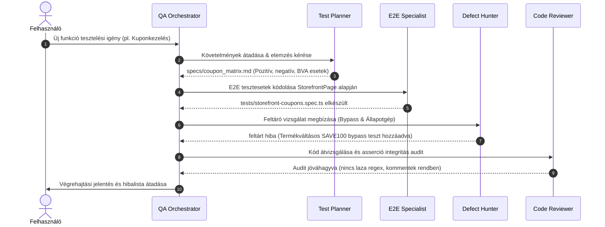

# Multi-Agent QA Architektúra és Subagent Rendszer
### Astron Informatikai Kft. | Playwright QA Automation Workspace | kzs Modul

Ez a dokumentum a keretrendszerhez kialakított specializált al-ágens (subagent) csapatot, a Page Object hozzáférési mátrixot, a munkafolyamatokat és az alkalmazandó szabványokat mutatja be részletesen.

---

## 1. Architektúrális Áttekintés és Page Object Hozzáférési Térkép

Az alábbi ábra szemlélteti, hogy melyik subagent milyen alkalmazáskomponensekhez, Page Object osztályokhoz fér hozzá, milyen feladatot végez rajtuk, és milyen kódolási és minőségi szabványokat köteles betartani:

```mermaid
flowchart TD
    subgraph Subagents["Specializált Subagensek"]
        Orchestrator["QA Orchestrator\n(Fő Koordinátor)"]
        Planner["Test Planner\n(Specifikáció & Mátrix)"]
        E2ESpec["E2E Specialist\n(UI Automatizáló)"]
        APISpec["API Specialist\n(REST API Tesztelő)"]
        Hunter["Defect Hunter\n(Feltáró & OWASP Tesztelő)"]
        Reviewer["Code Reviewer\n(Integritás & Auditáló)"]
    end

    subgraph PagesAndTargets["Céloldalak, Page Objectek & Rétegek"]
        Storefront["StorefrontPage.ts\n(Webshop, Kosár, Checkout)"]
        OrderMgmt["OrderManagementPage.ts\n(ERP Táblázat, Állapotgép)"]
        SelectorLab["SelectorLabPage.ts\n(DOM Lab, Fájlfeltöltés, Modálok)"]
        Swagger["SwaggerPage.ts & API Endpoints\n(REST API, Auth, Orders)"]
        SqlConsole["SqlConsolePage.ts\n(SQL Workbench, Audit Napló)"]
        SpecsRepo["specs/ & kzs/specs/\n(Követelmények, BVA Mátrixok)"]
        TestsRepo["tests/ & kzs/tests/\n(Minden *.spec.ts fájl)"]
    end

    subgraph Standards["Kötelező Szabványok és Szabályok"]
        StdAAA["AAA Minta\n(Arrange - Act - Assert)"]
        StdWebFirst["Web-First Lokátorok\n(getByRole, getByLabel, getByTestId)"]
        StdZeroWait["Zéró Manuális Várakozás\n(Nincs waitForTimeout / sleep)"]
        StdNoAssertPOM["Zéró Asserció POM-ban\n(expect kizárólag a tesztekben)"]
        StdDefect["Defect-Focused Mindset\n(Valós hiba assertálása, tilos maszkolni)"]
        StdComment["Kezdőbarát Kommentálás\n(JSDoc és inline technikai miértek)"]
        StdGit["Lokális Git Fegyelem\n(Commit lépésenként, nincs push)"]
    end

    %% Kapcsolatok a célokhoz
    Orchestrator --> Planner
    Orchestrator --> Reviewer
    Planner --> SpecsRepo

    E2ESpec --> Storefront
    E2ESpec --> OrderMgmt
    E2ESpec --> SelectorLab
    E2ESpec --> TestsRepo

    APISpec --> Swagger
    APISpec --> TestsRepo

    Hunter --> Storefront
    Hunter --> OrderMgmt
    Hunter --> SqlConsole
    Hunter --> Swagger
    Hunter --> SelectorLab
    Hunter --> TestsRepo

    Reviewer --> TestsRepo
    Reviewer --> Storefront
    Reviewer --> OrderMgmt
    Reviewer --> Swagger

    %% Szabványok hozzárendelése
    E2ESpec -.-> StdAAA
    E2ESpec -.-> StdWebFirst
    E2ESpec -.-> StdZeroWait
    E2ESpec -.-> StdNoAssertPOM
    E2ESpec -.-> StdComment

    APISpec -.-> StdAAA
    APISpec -.-> StdZeroWait
    APISpec -.-> StdComment

    Hunter -.-> StdDefect
    Hunter -.-> StdWebFirst
    Hunter -.-> StdComment

    Reviewer -.-> StdDefect
    Reviewer -.-> StdNoAssertPOM
    Reviewer -.-> StdComment

    Orchestrator -.-> StdGit
```

---

## 2. Page Object és Komponens Hozzáférési Mátrix

| Subagent | Hozzáférhető Page Objectek & Célok | Fő Műveletek és Felelősség | Kötelező Szabványok |
|---|---|---|---|
| **QA Orchestrator** | Teljes repository (`kzs/`, `pages/`, `tests/`) | Feladatbontás, prioritások, subagensek delegálása, záró szintézis. | Git izoláció, lokális commit ellenőrzés. |
| **Test Planner** | `kzs/specs/`, `specs/` | Specifikációk elemzése, határérték-elemzés (BVA), ekvivalencia partícionálás. | ISTQB szabványos tesztleírások, trace-ability. |
| **E2E Specialist** | `StorefrontPage`, `OrderManagementPage`, `SelectorLabPage` | Page Object osztályok metódusainak hívása, Happy path és negatív UI tesztek. | AAA minta, Web-First lokátorok, zéró `sleep`, zéró POM asserció. |
| **API Specialist** | `SwaggerPage`, `/api/clients/`, Playwright `request` | REST API végpontok meghívása, HTTP státuszok, JSON payload és séma validáció. | Gyors böngészőmentes futtatás, AAA minta, kontraktus-validáció. |
| **Defect Hunter** | `StorefrontPage`, `OrderManagementPage`, `SqlConsolePage`, `SelectorLabPage` | Érvénytelen bemenetek, peremértékek, állapotgép-bypass, adatbázis szinkronizáció, XSS/CSV injection. | Defect-Focused Mindset, soha nem maszkolja a hibát, szigorú elvárt üzleti asserciók. |
| **Code Reviewer** | Minden `*.spec.ts`, `*Page.ts` | Kódminőség audit, laza regexek és feltételes asserciók kiszűrése, kommentelés ellenőrzése. | Maszkolás-mentesség, kezdőbarát kommentelési standard, TypeScript strict check. |

---

## 3. Részletes Subagent Útmutatók (How-To Dokumentációk)

A subagensek részletes, lépésről lépésre követhető működési és kódolási útmutatói az alábbi fájlokban találhatók:

1. [QA Orchestrator Részletes How-To](file:///c:/Users/WDAGUtilityAccount/Desktop/AstronWorkshop/project/kzs/docs/subagents/qa-orchestrator.md)
2. [Test Planner Részletes How-To](file:///c:/Users/WDAGUtilityAccount/Desktop/AstronWorkshop/project/kzs/docs/subagents/test-planner.md)
3. [E2E Specialist Részletes How-To](file:///c:/Users/WDAGUtilityAccount/Desktop/AstronWorkshop/project/kzs/docs/subagents/e2e-specialist.md)
4. [API Specialist Részletes How-To](file:///c:/Users/WDAGUtilityAccount/Desktop/AstronWorkshop/project/kzs/docs/subagents/api-specialist.md)
5. [Defect Hunter Részletes How-To](file:///c:/Users/WDAGUtilityAccount/Desktop/AstronWorkshop/project/kzs/docs/subagents/defect-hunter.md)
6. [Code & Assertion Reviewer Részletes How-To](file:///c:/Users/WDAGUtilityAccount/Desktop/AstronWorkshop/project/kzs/docs/subagents/code-reviewer.md)

---

## 4. Együttműködési Életciklus Példa (End-to-End Workflow)

