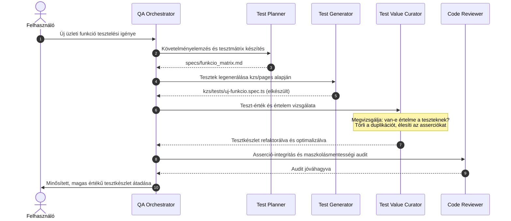

# Multi-Agent QA Architektúra és Subagent Rendszer
### Astron Informatikai Kft. | Playwright QA Automation Workspace | kzs Modul

Ez a dokumentum a keretrendszerhez kialakított specializált al-ágens (subagent) csapatot, a Page Object hozzáférési mátrixot, a munkafolyamatokat és az alkalmazandó szabványokat mutatja be részletesen.

---

## 1. Architektúrális Áttekintés és Page Object Hozzáférési Térkép

Az alábbi ábra szemlélteti a teljes 8 ágensből álló multi-agent csapatot, hogy melyik subagent milyen alkalmazáskomponensekhez, Page Object osztályokhoz fér hozzá, milyen feladatot végez rajtuk, és milyen kódolási és minőségi szabványokat köteles betartani:

```mermaid
flowchart TD
    subgraph Subagents["Specializált Subagensek (8 Szerepkör)"]
        Orchestrator["QA Orchestrator\n(Fő Koordinátor)"]
        Planner["Test Planner\n(Specifikáció & Mátrix)"]
        Generator["Test Generator\n(Automatizált Tesztíró)"]
        Curator["Test Value Curator\n(Értékvizsgáló & Optimalizáló)"]
        E2ESpec["E2E Specialist\n(UI Automatizáló)"]
        APISpec["API Specialist\n(REST API Tesztelő)"]
        Hunter["Defect Hunter\n(Feltáró & OWASP Tesztelő)"]
        Reviewer["Code Reviewer\n(Integritás & Auditáló)"]
    end

    subgraph PagesAndTargets["Céloldalak, Page Objectek & Rétegek"]
        Storefront["StorefrontPage.ts\n(Webshop, Kosár, Checkout)"]
        OrderMgmt["OrderManagementPage.ts\n(ERP Táblázat, Állapotgép)"]
        SelectorLab["SelectorLabPage.ts\n(DOM Lab, Fájlfeltöltés, Modálok)"]
        Swagger["SwaggerPage.ts & API Endpoints\n(REST API, Auth, Orders)"]
        SqlConsole["SqlConsolePage.ts\n(SQL Workbench, Audit Napló)"]
        SpecsRepo["specs/ & kzs/specs/\n(Követelmények, BVA Mátrixok)"]
        TestsRepo["kzs/tests/*.spec.ts\n(Teljes Tesztkészlet)"]
    end

    subgraph Standards["Kötelező Szabványok és Szabályok"]
        StdAAA["AAA Minta\n(Arrange - Act - Assert)"]
        StdWebFirst["Web-First Lokátorok\n(getByRole, getByLabel, getByTestId)"]
        StdZeroWait["Zéró Manuális Várakozás\n(Nincs waitForTimeout / sleep)"]
        StdNoAssertPOM["Zéró Asserció POM-ban\n(expect kizárólag a tesztekben)"]
        StdDefect["Defect-Focused Mindset\n(Valós hiba assertálása, tilos maszkolni)"]
        StdValue["Business Value & ROI\n(Tautológia- és redundanciamentesség)"]
        StdComment["Kezdőbarát Kommentálás\n(JSDoc és inline technikai miértek)"]
        StdGit["Lokális Git Fegyelem\n(Commit lépésenként, nincs push)"]
    end

    %% Kapcsolatok a célokhoz
    Orchestrator --> Planner
    Orchestrator --> Generator
    Orchestrator --> Curator
    Orchestrator --> Reviewer
    Planner --> SpecsRepo

    Generator --> Storefront
    Generator --> OrderMgmt
    Generator --> SelectorLab
    Generator --> TestsRepo

    Curator --> TestsRepo
    Curator --> Storefront
    Curator --> OrderMgmt

    E2ESpec --> Storefront
    E2ESpec --> OrderMgmt
    E2ESpec --> SelectorLab
    E2ESpec --> TestsRepo

    APISpec --> Swagger
    APISpec --> TestsRepo

    Hunter --> Storefront
    Hunter --> OrderMgmt
    Hunter --> SqlConsole
    Hunter --> Swagger
    Hunter --> SelectorLab
    Hunter --> TestsRepo

    Reviewer --> TestsRepo
    Reviewer --> Storefront
    Reviewer --> OrderMgmt

    %% Szabványok hozzárendelése
    Generator -.-> StdAAA
    Generator -.-> StdWebFirst
    Generator -.-> StdNoAssertPOM
    Generator -.-> StdComment

    Curator -.-> StdValue
    Curator -.-> StdDefect
    Curator -.-> StdWebFirst

    E2ESpec -.-> StdAAA
    E2ESpec -.-> StdWebFirst
    E2ESpec -.-> StdZeroWait

    APISpec -.-> StdAAA
    APISpec -.-> StdZeroWait

    Hunter -.-> StdDefect
    Hunter -.-> StdWebFirst

    Reviewer -.-> StdDefect
    Reviewer -.-> StdComment

    Orchestrator -.-> StdGit
```

---

## 2. Részletes Szerepkör- és Hozzáférési Mátrix

| Subagent | Fájl / Útmutató | Hozzáférések | Fő Felelősség és Működés |
|---|---|---|---|
| **QA Orchestrator** | [qa-orchestrator.md](file:///c:/Users/WDAGUtilityAccount/Desktop/AstronWorkshop/project/kzs/docs/subagents/qa-orchestrator.md) | Teljes repository | Feladatbontás, koordináció, Plan Mode jóváhagyások, szintézis. |
| **Test Planner** | [test-planner.md](file:///c:/Users/WDAGUtilityAccount/Desktop/AstronWorkshop/project/kzs/docs/subagents/test-planner.md) | `kzs/specs/`, `specs/` | Követelményelemzés, BVA határértékek, ekvivalencia partícionálás, tesztmátrixok. |
| **Test Generator** | [test-generator.md](file:///c:/Users/WDAGUtilityAccount/Desktop/AstronWorkshop/project/kzs/docs/subagents/test-generator.md) | `kzs/pages/`, `kzs/tests/` | Új tesztek automatizált kódolása a `kzs/pages` POM osztályok használatával és kezdőbarát kommentekkel. |
| **Test Value Curator**| [test-curator.md](file:///c:/Users/WDAGUtilityAccount/Desktop/AstronWorkshop/project/kzs/docs/subagents/test-curator.md) | `kzs/tests/`, `kzs/pages/` | Tesztek értékének és értelmének vizsgálata (ROI), redundanciák törlése, gyenge asserciók élesítése, a tesztkészlet közvetlen módosítása. |
| **E2E Specialist** | [e2e-specialist.md](file:///c:/Users/WDAGUtilityAccount/Desktop/AstronWorkshop/project/kzs/docs/subagents/e2e-specialist.md) | `StorefrontPage`, `OrderManagementPage`, `SelectorLabPage` | Page Object osztályok metódusai, Happy path és negatív UI E2E tesztek. |
| **API Specialist** | [api-specialist.md](file:///c:/Users/WDAGUtilityAccount/Desktop/AstronWorkshop/project/kzs/docs/subagents/api-specialist.md) | `SwaggerPage`, `/api/clients/`, Playwright `request` | Böngésző nélküli gyors REST API tesztek, státuszkódok és JSON sémák validálása. |
| **Defect Hunter** | [defect-hunter.md](file:///c:/Users/WDAGUtilityAccount/Desktop/AstronWorkshop/project/kzs/docs/subagents/defect-hunter.md) | Valamennyi oldal és réteg | Exploratory tesztelés, negatív határesetek, állapotgép-rések, Stored XSS, CSV injekciók. |
| **Code Reviewer** | [code-reviewer.md](file:///c:/Users/WDAGUtilityAccount/Desktop/AstronWorkshop/project/kzs/docs/subagents/code-reviewer.md) | Minden `*.spec.ts`, `*Page.ts` | Kódminőség audit, laza regexek (`/valid/i`) és feltételes asserciók kiszűrése. |

---

## 3. Együttműködési Életciklus a Generáló és Értékvizsgáló Ágensekkel

